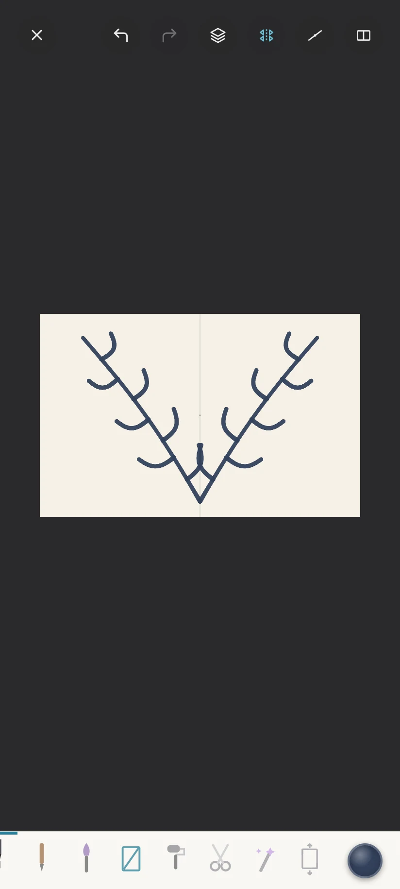
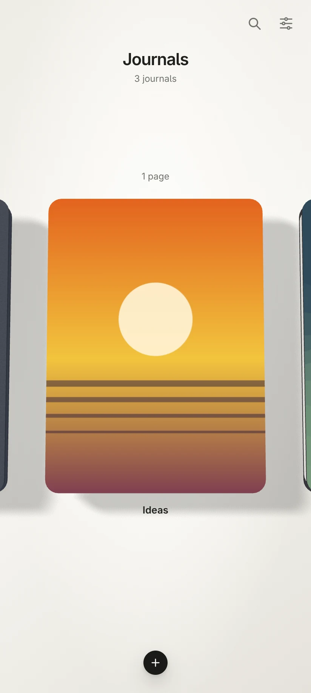
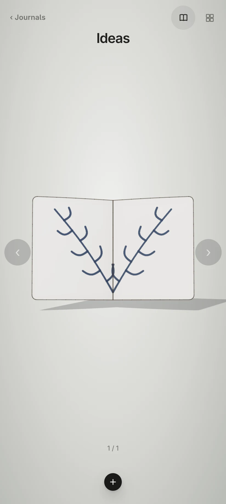
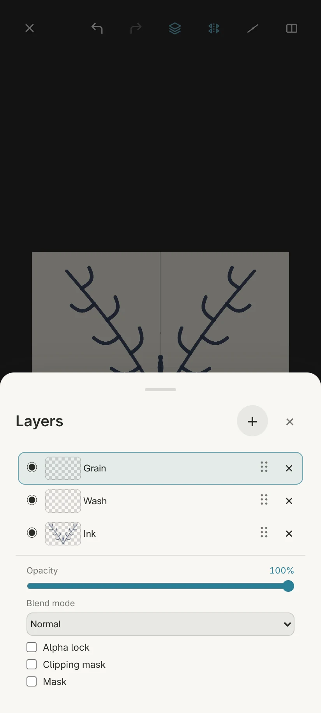
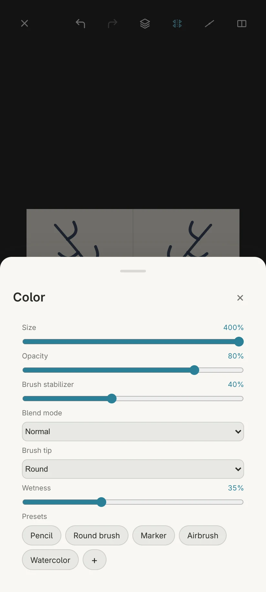
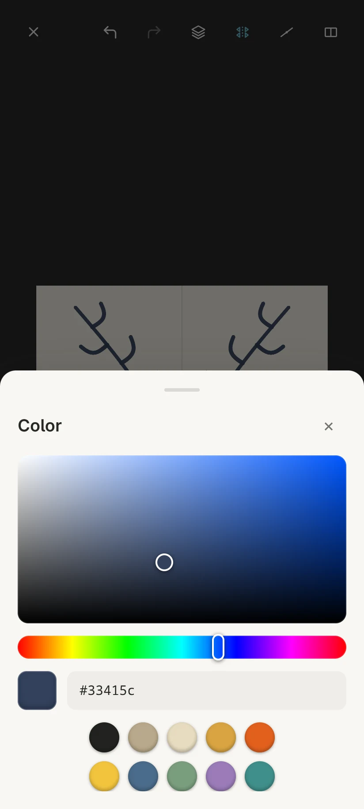

# Vihko

Notebooks that feel like paper: natural ink tools, layers, and a shelf of books you can
actually flip through. Android-first, built as a hybrid app — Vue 3 + TypeScript, a
Go→WASM ink engine, three.js for the 3D views, Capacitor for the native shell.

[](https://github.com/quonaro/Vihko/actions/workflows/ci.yml)
[](https://github.com/quonaro/Vihko/releases)
[](LICENSE)

<p align="center">
  
</p>

**English** · [Русский](README.ru.md)

## Download

Grab the latest `vihko-*.apk` from [Releases](https://github.com/quonaro/Vihko/releases)
and install it on any Android 7.0+ device. Debug builds install side by side as
"Vihko Dev" (`vihko.app.dev`), release builds as `vihko.app`.

## What's in it

**Ink**

- Five ink tools (draw, sketch, outline, write, watercolour) with pressure, tapering and
  a per-brush stabiliser; textured tips (grain, airbrush, marker) and named presets.
- Watercolour picks up the colour already on the page and re-deposits the mix, so
  overlapping strokes blend instead of stacking.
- Eraser, flood fill (colour-aware, with inverse and "erase colour" modes), filters
  (brightness / contrast / saturation / blur / sharpen), six vector shapes, lasso cut
  and move.
- Text blocks: tap the page, type in a bottom sheet, and the block is placed as a
  page-unit op — four built-in fonts, size, bold/italic and left/centre/right
  alignment, wrapped to the sheet or the focused half. Fonts can be imported from
  the device (TTF / OTF / WOFF / WOFF2) and stay in the local library offline.
- Symmetry (vertical / horizontal / both) and drawing guides — a straightedge or a
  french curve that snaps your strokes.
- Real stylus pressure, coalesced + predicted pointer events for a low-latency line,
  palm rejection while the pen is down.

**Pages and books**

- Ordered layers with per-layer opacity, 10 blend modes, alpha lock, clipping masks,
  layer masks, transform with rotation, and live thumbnails.
- Landscape pages can be worked half-by-half: the fold becomes a hard edge for painting
  and for the fill tools.
- Photo collage from the gallery, PNG export, journal export as JSON.
- Shelf and journal views are real 3D: books tilt towards the pointer, pages turn with
  an animation, and the renderer idles when nothing moves.
- Cover art from generated presets, a photo, or three paper textures.
- Journal search, rename, delete; the whole app works offline.

## Screenshots

<table>
  <tr>
    <td align="center"><br><sub>3D shelf</sub></td>
    <td align="center"><br><sub>Journal spread</sub></td>
    <td align="center"><br><sub>Layers</sub></td>
  </tr>
  <tr>
    <td align="center"><br><sub>Brush panel</sub></td>
    <td align="center"><br><sub>Colour picker (RYB mixing)</sub></td>
    <td align="center"><br><sub>Canvas</sub></td>
  </tr>
</table>

## How it works

- **Ink engine (`engine/`)** — Go compiled to WASM. A port of the perfect-freehand
  stroke model adapted to incremental sampling: streamline input smoothing, real stylus
  pressure when it varies (auto-detected) or speed-simulated pressure otherwise, start
  and end tapers, a noise gate, and a full-size dot for taps. `px.go` adds pixel kernels
  — flood fill, blur, sharpen, adjust and the wet-mixing watercolour dab — so the heavy
  loops run in Go, not JS.
- **App (`src/`)** — Vue 3 + TypeScript. Every stroke stores the brush parameters it was
  drawn with, so replay is deterministic: undo/redo, layer rasterisation and textures all
  replay the same vector data. A pure-JS copy of the engine is kept in lockstep for
  browsers without WASM.
- **3D (`src/three/`)** — three.js shelf and book spread with raycast picking, projected
  DOM labels and render-on-demand; the layout math is pure and unit tested.
- **Storage** — per-row persistence (index, `journal:<id>`, `page:<id>`): editing a page
  serialises one page, not the whole library. SQLite on device, IndexedDB in a browser,
  with a migration path from the original single-blob save.
- **Shell** — Capacitor 8, edge-to-edge window with safe-area insets forwarded to CSS,
  status bar hidden in the editor, in-app APK updates with a system installer intent.

Architecture notes, conventions and gotchas live in [AGENTS.md](AGENTS.md).

## Build

Requires Node 24 + pnpm, Go 1.27 (for the WASM engine), and for the APK: JDK 21 and the
Android SDK.

Tasks live in [`lota.yml`](lota.yml) and run with [lota](https://github.com/quonaro/lota),
a small YAML task runner I wrote for this kind of project:

```sh
go install github.com/quonaro/lota@latest

lota install        # pnpm install
lota dev web        # vite on :7357, builds the WASM engine first
lota build web      # wasm + typecheck + vite build → dist/
lota test           # vitest + go test
lota preview        # serve the production build from dist/
lota build apk      # debug APK (installs as vihko.app.dev alongside the release)
lota dev android    # live reload on a device/emulator, boots an AVD if none is up
lota cap android    # sync + open Android Studio
lota push v0.0.13   # push with a tag → the release workflow builds the signed APK
```

Without lota, the same steps are the `pnpm` scripts in `package.json`: `pnpm dev`,
`pnpm build`, `pnpm test`, `pnpm test:go`, `pnpm lint`, `pnpm cap:sync`,
`pnpm cap:android`.

Releases are built by GitHub Actions on a `v*.*.*` tag: tests, release APK signed with
the keystore from repo secrets, uploaded to the GitHub Release.

## Status

- Android is the target platform; the `ios/` project is scaffolded but has never been
  built (no macOS here).
- Local-only: no accounts, no cloud sync. Journals live in the app's SQLite database.
- UI is English and Russian.
- 3D views need WebGL; without it the app shows an "unavailable" message instead of
  falling back to a flat renderer.

## Contributing

Issues and pull requests are welcome — see [CONTRIBUTING.md](CONTRIBUTING.md) for setup,
the checks CI runs, and the conventions (tests are required, the Go engine and the JS
fallback move together, mobile-first layout).

## License

MIT — see [LICENSE](LICENSE).
