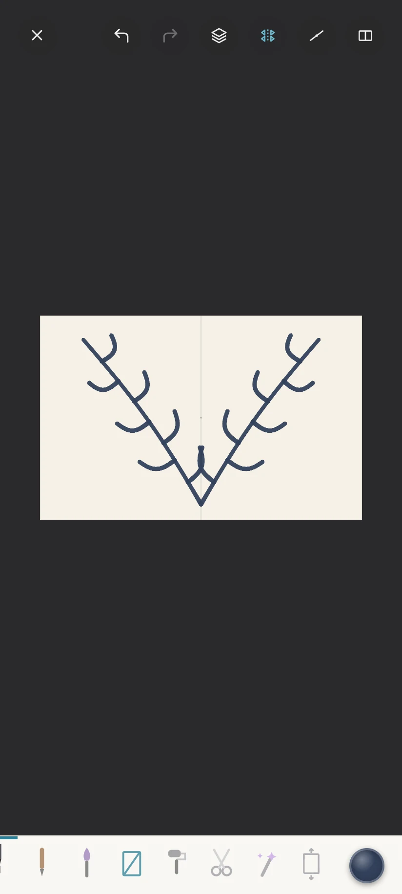
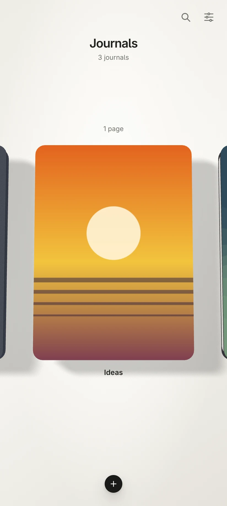
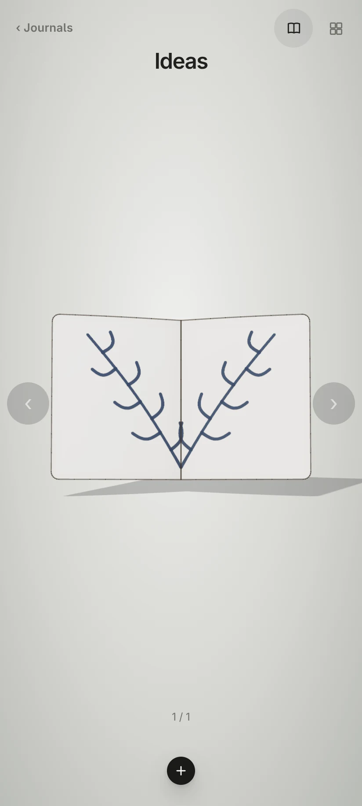
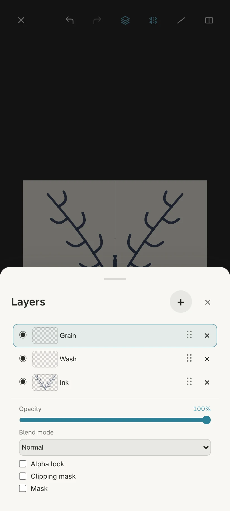
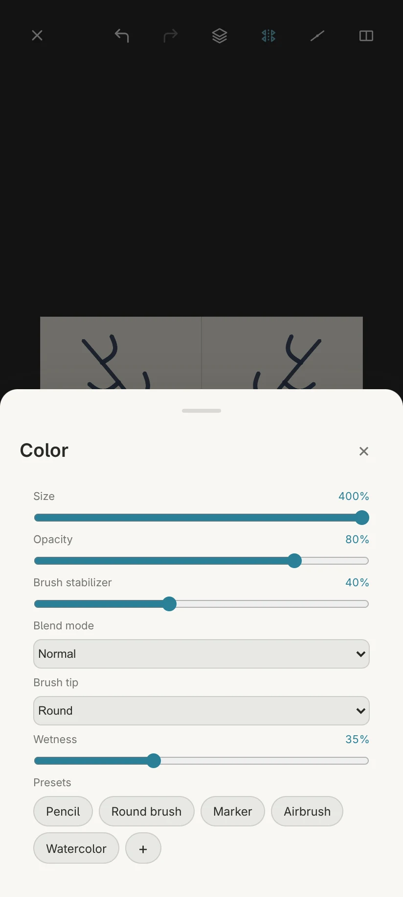
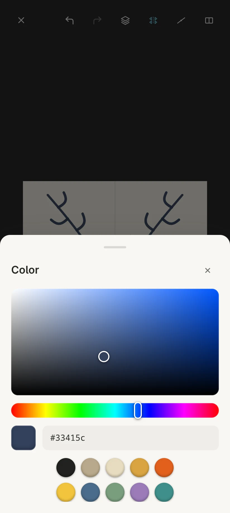

# Vihko

Блокноты, которые ощущаются как бумага: живые чернильные инструменты, слои и полка с
книгами, которые можно листать. Сначала Android: гибридное приложение на Vue 3 +
TypeScript с чернильным движком Go→WASM, three.js для 3D-видов и Capacitor в роли
нативной оболочки.

[](https://github.com/quonaro/Vihko/actions/workflows/ci.yml)
[](https://github.com/quonaro/Vihko/releases)
[](LICENSE)

<p align="center">
  
</p>

[English](README.md) · **Русский**

## Скачать

Последний `vihko-*.apk` лежит в [Releases](https://github.com/quonaro/Vihko/releases) —
ставится на любой Android 7.0+. Debug-сборки устанавливаются рядом как "Vihko Dev"
(`vihko.app.dev`), релизные — как `vihko.app`.

## Что внутри

**Чернила**

- Пять чернильных инструментов (перо, карандаш, маркер, ручка, акварель) с нажимом,
  сбегающими концами штриха и стабилизатором для каждой кисти; текстурные наконечники
  (зерно, аэрограф, маркер) и именованные пресеты.
- Акварель подхватывает цвет, который уже есть на листе, и возвращает смесь обратно —
  перекрывающиеся мазки смешиваются, а не наслаиваются.
- Ластик, умная заливка (с режимами «инверсия» и «стереть цвет»), фильтры
  (яркость / контраст / насыщенность / размытие / резкость), шесть векторных фигур,
  лассо с переносом выделенного.
- Симметрия (вертикальная / горизонтальная / обе) и направляющие: линейка и лекало,
  к которым прилипает штрих.
- Настоящий нажим стилуса, объединённые и предсказанные события указателя для
  отзывчивой линии, отсев касаний ладонью, пока перо на экране.

**Страницы и блокноты**

- Упорядоченные слои: прозрачность, 10 режимов наложения, alpha lock, обтравочные
  маски, маски слоя, трансформация с поворотом и живые миниатюры.
- На альбомных страницах можно работать по половинам: сгиб становится жёсткой границей
  и для кисти, и для инструментов заливки.
- Коллаж из фотографий галереи, экспорт страницы в PNG, экспорт блокнота в JSON.
- Полка и разворот — настоящий 3D: книги наклоняются за указателем, страницы
  переворачиваются с анимацией, а рендер засыпает, когда ничего не движется.
- Обложки из сгенерированных пресетов, из фото или из трёх бумажных текстур.
- Поиск, переименование и удаление блокнотов; всё приложение работает офлайн.

## Скриншоты

<table>
  <tr>
    <td align="center"><br><sub>Полка 3D</sub></td>
    <td align="center"><br><sub>Разворот блокнота</sub></td>
    <td align="center"><br><sub>Слои</sub></td>
  </tr>
  <tr>
    <td align="center"><br><sub>Панель кисти</sub></td>
    <td align="center"><br><sub>Выбор цвета (смешивание RYB)</sub></td>
    <td align="center"><br><sub>Холст</sub></td>
  </tr>
</table>

## Как это устроено

- **Чернильный движок (`engine/`)** — Go, скомпилированный в WASM. Порт модели штриха
  perfect-freehand, адаптированный под инкрементальную выборку: сглаживание ввода,
  настоящий нажим стилуса, когда он меняется (определяется автоматически), или нажим,
  смоделированный по скорости; сбегающие начало и конец, порог шума и полноразмерная
  точка для тапа. `px.go` добавляет пиксельные ядра — заливку, размытие, резкость,
  коррекцию и «мокрый» акварельный мазок — так что тяжёлые циклы идут в Go, а не в JS.
- **Приложение (`src/`)** — Vue 3 + TypeScript. Каждый штрих хранит параметры кисти, с
  которыми он нарисован, поэтому воспроизведение детерминировано: undo/redo,
  растеризация слоёв и текстуры проигрывают одни и те же векторные данные. Для браузеров
  без WASM поддерживается чистая JS-копия движка в том же состоянии.
- **3D (`src/three/`)** — полка и разворот на three.js: выбор по лучу, DOM-подписи по
  проекции и рендер по требованию; математика раскладки вынесена отдельно и покрыта
  тестами.
- **Хранение** — построчное сохранение (индекс, `journal:<id>`, `page:<id>`): правка
  страницы сериализует одну страницу, а не всю библиотеку. SQLite на устройстве,
  IndexedDB в браузере, с миграцией со старого сохранения одним блоком.
- **Оболочка** — Capacitor 8, окно edge-to-edge с прокинутыми в CSS safe-area
  отступами, скрытый в редакторе статус-бар, обновление APK прямо из приложения через
  системный интент установщика.

Заметки по архитектуре, соглашения и подводные камни — в [AGENTS.md](AGENTS.md)
(по-английски).

## Сборка

Нужны Node 24 + pnpm, Go 1.27 (для WASM-движка), а для APK — JDK 21 и Android SDK.

Задачи описаны в [`lota.yml`](lota.yml) и запускаются через
[lota](https://github.com/quonaro/lota) — небольшой YAML-раннер задач, который я написал
для таких проектов:

```sh
go install github.com/quonaro/lota@latest

lota install        # pnpm install
lota dev web        # vite на :7357, сначала собирает WASM-движок
lota build web      # wasm + typecheck + vite build → dist/
lota test           # vitest + go test
lota preview        # раздача продакшн-сборки из dist/
lota build apk      # debug APK (ставится как vihko.app.dev рядом с релизом)
lota dev android    # live reload на устройстве/эмуляторе, при необходимости поднимет AVD
lota cap android    # sync + открыть Android Studio
lota push v0.0.13   # пуш с тегом → workflow релиза соберёт подписанный APK
```

Без lota те же шаги — это `pnpm`-скрипты из `package.json`: `pnpm dev`, `pnpm build`,
`pnpm test`, `pnpm test:go`, `pnpm lint`, `pnpm cap:sync`, `pnpm cap:android`.

Релизы собирает GitHub Actions по тегу `v*.*.*`: тесты, подписанный релизным ключом из
секретов репозитория APK и загрузка его в GitHub Release.

## Статус

- Целевая платформа — Android; проект `ios/` создан, но ни разу не собирался (macOS тут
  нет).
- Только локально: ни аккаунтов, ни облачной синхронизации. Блокноты живут в SQLite
  внутри приложения.
- Интерфейс на английском и русском.
- 3D-видам нужен WebGL; без него приложение показывает сообщение «недоступно», а не
  переключается на плоский рендер.

## Участие

Issues и pull request'ы приветствуются — как всё поднять, какие проверки гоняет CI и
какие правила действуют, написано в [CONTRIBUTING.md](CONTRIBUTING.md) (по-английски):
тесты обязательны, Go-движок и JS-фолбэк меняются вместе, вёрстка сначала под телефон.

## Лицензия

MIT — см. [LICENSE](LICENSE).
